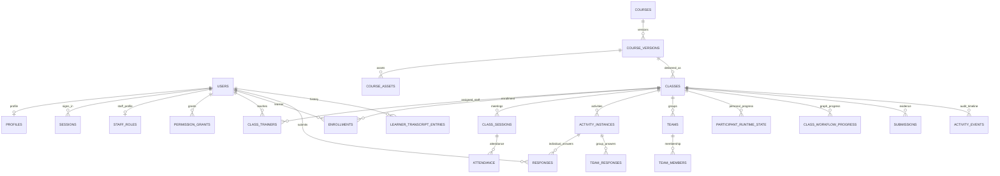

# RC1R5 database architecture review — pre-change baseline

This document describes inspected RC1R5 behavior and proposed improvements. It authorizes no migration. The complete table, column, relationship, index and row-count inventory is in `verification/database-inventory-baseline.json`. No credential values or profile contents are included.

## Observed storage and ownership

The system is one Node HTTP process with synchronous `node:sqlite`. SQLite uses WAL, foreign keys, and `synchronous=NORMAL`. The runtime defaults to `data/training-engine.sqlite`. Assets/submissions live in filesystem storage and have database references. Backups and exports have separate configurable paths.

The packaged active database has 53 application tables and 17 explicit indexes. Integrity and foreign-key checks passed on a copied database, including its supplied WAL/SHM. It contains nine users, one course/version/class, zero responses/submissions and one session row. The differently named `training_engine.sqlite` contains no tables. This second file is not the default runtime database. Preserve both originals while resolving packaging provenance; do not delete production state by filename inference.

There is no organization/tenant entity or tenant key. Roles are `trainer` and `student`, extended by staff roles, class assignments and permission grants. A school Teacher profile would need deliberate mapping to permissions rather than merely changing a displayed label.

## Entity and relationship map

Course definitions, workflows, path steps and activity settings are declarative JSON within versioned course content. Live instances retain definition JSON. Aggregate results and most analytics are derived from persisted responses/events; they are not independent authoritative course definitions. Reports can retain JSON snapshots. Session Replay is an event/instance timeline, not a recording of every rendered frame.

Additional entity groups cover mission/objective progress, achievements, help requests, notifications/receipts, consents/history, draft snapshots/templates, rubrics, certificates, prerequisites, waitlists, surveys, question banks/quizzes/attempts, saved views and settings.

## Current migration assessment

`initSchema`, `migrateV2` and `migrateOne` run at database open. They use table existence and column inspection, additive columns/tables, and table rebuilds for widened CHECK constraints. `schema_meta` stores current schema/application identity. There is no ordered migration execution journal with per-migration checksums. Migration routines are not enclosed in one explicit transaction. Foreign keys are temporarily disabled for two rebuilds.

The unchanged populated v2.1.1 fixture migration test passed, including preserved users/course/class/enrollment/submission/event records and post-migration integrity. This is useful compatibility evidence, not crash-injection, downgrade or arbitrary-database coverage. Current startup also seeds demonstration data and a fixed bootstrap administrator when missing; provisioning must be separated from production upgrades.

Before any schema change: record source release/schema identity; take and verify database+asset backup; define deterministic versioned migration and idempotency; test populated historical and current databases; preserve IDs/version lineage; test process failure between migration steps; specify rollback or restoration behavior; validate integrity/FKs and representative old courses/reports afterward. Do not silently promote unknown future schemas to the current version.

## Backup/recovery

The current backup path checkpoints SQLite and uses `VACUUM INTO`, copies storage, records hashes and verifies database integrity/FKs. Portable exports use scrypt plus AES-256-GCM. Restore verifies the incoming backup, optionally makes a safety backup, replaces database/storage, reopens/migrates the restored database and invalidates sessions.

Observed risk: replacement is not an atomic filesystem transaction. The failure handler reopens the current replacement database; it does not automatically recover the pre-restore state from the safety backup. Failure-injection coverage is needed before claiming durable rollback. Define supported state precisely: database+storage backups do not currently constitute a recursive archive of previous backups, exports, source or arbitrary external files.

## Hot paths and privacy

Indexes support class/time events, instance responses, learner enrollment, permissions, help/runtime/workflow states, notifications, sessions, submission review, consent history, Projector pairs, banks and transcripts. Each authenticated request updates session last-seen; participant dashboards perform multiple per-class aggregates. Live polling, SSE-triggered refresh, synchronous password hashing, backup copying and analytical loops share the Node event loop. Profile representative classroom loads before changing storage architecture.

Names, profiles, attendance, submissions, answer histories, notes, help messages, login IP/device metadata, consents and reports are sensitive. Retention is not a complete versioned policy covering all these entities. Many learner/course/class deletions cascade; deletion, archival, retention and restore semantics require explicit coverage. Audit events are application-managed database rows, not cryptographically tamper-evident records.

Confirmed access defect: a scoped Trainer is denied direct analytics access to an unassigned class (403), but an assigned class's cohort-comparison response includes that unassigned class (200). Authorization must be applied throughout analytical derivation, not only to the entry endpoint.

## Proposed school foundation — subject to owner scope

Use one codebase and configurable capability profiles. For the recommended initial single-organization deployment, map professional Trainer and school Teacher workflows onto the existing class/course/delivery model; add school-specific metadata/entities only for approved scope. Preserve existing IDs and leave professional navigation free of disabled school clutter. Do not claim multi-tenant isolation until organization membership, every ownership key/query, authorization, analytics, assets, backups and migrations are designed and verified.

If academic essentials are approved, add explicit academic terms, subject/catalog references, sections and enrollments, assignments, grading schemes/rubrics and gradebook records without replacing immutable delivered course versions or existing assessment history. Guardian links, safeguarding access and retention must be separately specified for the launch audience/jurisdiction. Migration-impact analysis is mandatory before implementation.
