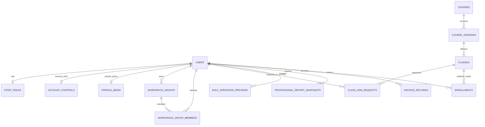

# RC1R8 data architecture and upgrade impact

Read DATABASE_ARCHITECTURE_REVIEW_BASELINE.md for the preserved course/class/response/session/asset/report model. The current implementation remains a single local organization, one Node HTTP process, synchronous SQLite with foreign keys/WAL, and separate backed-up filesystem storage. No tenant keys or school tables are introduced. Current core/data identity is 3.2, course schema 2.0 and workspace journal version 4.

Migration impact was recorded before schema edits in RC1R8_APPROVED_SCOPE_AND_MIGRATION.md. workspace-migrations.mjs mechanically defines four transactionally applied, checksummed SQL migrations. Accepted SQL checksum drift fails closed. Each migration commits its journal entry and foreign-key verification atomically; failed DDL rolls back. No supported historical row is discarded.

0001 widens staff_roles by copying existing roles and timestamps, then adds groups, membership, admission requests, photo metadata and actor-bound bulk previews. 0002 adds archive snapshots. 0003 adds trusted registered/legacy_guest account kind and derives historical guest classification from trusted existing events, not editable profile claims. 0004 adds professional report snapshots without changing legacy report_snapshots. The journal itself records version/checksum/applied time.

Before pending extension migration on an existing database, VACUUM INTO creates a database snapshot; storage is copied without following symlinks; integrity, per-file hashes and manifest are verified before atomic backup-directory promotion. Backups must remain outside active storage. Startup listener checks happen before opening/migrating the database, reducing overlapping old/new-process upgrade risk. Keep the old process stopped throughout the update.

Group membership is unique per group/user, never globally unique; applying a group inserts class assignments/enrollments as a reviewed snapshot. Enrollment uniqueness remains class/student. Withdrawal changes status; upsert re-enrollment restores active status without deleting progress/response/history. Admission uniqueness is class/student with explicit status/revision; decision transactions recheck authorization, account activity, prerequisites and capacity. Expected revisions detect stale decisions; repeat accepted decisions do not duplicate writes. Closing a class cancels pending requests.

Bulk previews bind token/actor/payload/source-state SHA/expiry. Apply rechecks current permissions/source state inside a transaction, marks the accepted preview and writes audit evidence. A repeat apply is idempotent. Account deactivation revokes sessions; restoration does not recreate them. Last-super/current-account protections remain server-side.

Profile-media keys are server-generated, stored in storage/profile-media and scoped through authorized endpoints. Branding/logo is a central setting plus storage/branding. Report snapshots bind owner/template/resource and immutable reviewed data, branding/logo bytes, font IDs/hashes and expiry. Paths are resolved from the current local verified font catalog at export rather than storing machine-specific runtime paths. PDFs reside in storage/professional-reports with SHA-256. Current resource/class scope is rechecked before download, including saved exports. Worker threads render a snapshot without using the live database connection; main-process authorizations/database mutations remain authoritative.

New indexes cover group ownership/membership lookups, admission class/status and learner inbox, preview expiry, archive identity and report owner/date. Foreign keys retain actor/user ownership. The audit query applies authorized scope before its limit. Existing operational/report indexes and data remain unchanged. Report payloads exclude raw answers, correct answers, trainer notes and unrelated learner contacts; authorized personal information in saved reports/photos must be included in retention/privacy policy and verified backups.

Populated v2.1.1 and exact RC1R7-generated fixtures test unchanged user/password/profile/course/version/class/enrollment/response bytes, withdrawn history, guest classification, verified pre-upgrade storage snapshot, repeat startup, journal drift, atomic DDL failure and foreign keys. Operational tests include new group state in backup/restore. Existing full restore-interruption, restart, activity/history and backup regressions remain release gates.
