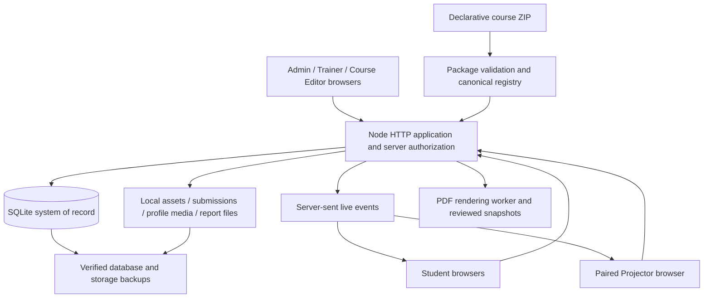

# Training Engine ONE — current RC1R10 blueprint

Snapshot date: 2026-10-15. Baseline: repository `worldrahmah/training`, `release/rc1r10-test` at `0197a9144631e90e8972119be52a388482f1b591`. This document describes the existing system. Proposed school capabilities appear separately in document 02.

## 1. Product identity and purpose

Training Engine ONE is a local-first, bilingual platform for declarative course authoring, training delivery, interactive classroom participation and learning operations. It supports live Trainer-led teaching, participant-paced learning and front-of-room presentation. It is a useful teaching foundation for a school product; it does not currently provide a complete school academic administration model.

| Fact | Current value |
|---|---|
| Application | Training Engine ONE 3.5.0-rc.1.10 |
| Release status | OWNER_ACCEPTANCE_CANDIDATE_NOT_FINAL |
| Core/data identity | 3.2 |
| Current authoring schema | 2.0; historical 1.0/1.1 compatibility retained |
| Canonical activities | 36 stable type IDs |
| Certified result-view cases | 68 activity/result combinations, not 68 activity types |
| Organization model | Single local organization; no certified multi-tenant isolation |
| UI languages | English LTR, Arabic RTL; independent of authored course language |
| Deployment | Windows/classroom LAN; local Linux/macOS startup also supplied |

RC1R8 was the accepted engineering foundation; RC1R9 added branding, bilingual guidance, the current authoring kit and security work; RC1R10 addressed ten owner workflow issues. Automation does not establish final owner classroom acceptance.

## 2. Runtime architecture

- Node **22.5+**, ES modules, native HTTP, `node:sqlite` synchronous database, foreign keys and WAL. Tested release environment used Node 24.19.0.
- Browser UI uses existing HTML/CSS/JavaScript surfaces. The server is authoritative for roles, resource scope, submissions, scoring and reveal access.
- One local organization and one application process are the established operating model. Multiple classes can run simultaneously; this is not distributed server clustering.
- SQLite and filesystem storage together form persistent state. Copying only the database is not a complete backup.
- `data/`, `storage/`, `backups/` and `exports/` paths can be configured. Do not run two servers against the same database.
- Bundled application dependencies, licensed local fonts and PDF runtime support classroom operation without a cloud service or routine npm installation. Some authored external resources can still require Internet access.
- Server-sent events distribute live state. Supported response queuing and reconnect are not a complete offline replica or multi-site synchronization system.

## 3. Roles and surfaces

| Role/surface | Current purpose and boundary |
|---|---|
| Super administrator / administrator, `/admin` | Installation-wide people, courses, classes, settings, reports and privileged operations according to role; protected super-admin controls |
| Trainer, `/trainer` | Assigned/scoped courses and classes, roster operations, attendance, teams, communication and reporting as granted |
| Assistant | Staff profile with scoped capabilities; not automatic administrator access |
| Course Editor, `/builder` | Isolated assigned/owned authoring work, with separate per-course publication permission; not a general classroom manager |
| Live Trainer console | Class flow, activity opening/closing, moderation, reveal, help queue, progress and private facilitation cues |
| Student / Participant, `/student` | Registered learning account, class participation, paths, submissions, history, profile and permitted reports |
| Projector, `/present` | Audience-safe paired display; distinct from the private Trainer console |
| Profile and analytics surfaces | Authorized personal/history views and scoped reporting; not new independent roles |

The underlying user role field distinguishes Trainer and Student; staff profiles and resource permission grants add richer roles. Adding school roles is a permission/data design task, not simply adding names to a menu.

RC1R10 adds opt-in restrictions for view/edit/publish/archive and class actions such as control, enrollment, teams, attendance, messaging and participant management. Existing assignment behavior remains until customized. Wildcard and specific grants combine. Course Editor isolation remains authoritative. Older application code does not enforce the new restrictions, which matters for rollback.

## 4. Canonical learning and delivery model

| Concept | Existing meaning |
|---|---|
| Course | Reusable authored learning definition with stable identity |
| Course version | Draft, published or archived content; delivered published versions immutable |
| Module/milestone | Objectives, timing, activities, missions, paths and optional workflow |
| Activity | One of the 36 registered declarative interactions |
| Mission | Guided work/submission component; not an extra ordinary activity type |
| Participant path | Ordered personal learning steps, completion and supported branching |
| Explicit workflow | Validated nodes, edges, class/participant scopes, convergence and terminals |
| Class | Delivery of a particular course version; not an academic year-group or permanent school homeroom |
| Class session | Scheduled occurrence within a delivery class, used for attendance |
| Enrollment | Student membership/status for a delivery class, preserving previous evidence on re-enrollment |
| Team | Class-specific collaboration membership, with history-preserving identity |
| Group | Reusable staff/participant collection; class application is a reviewed snapshot, not permission inheritance |

Normal lifecycle: author/import → validate → save Draft → review/simulate → publish immutable version → create class → assign staff/enroll students → deliver → record evidence/review → report/archive. Editing published content creates a new Draft/version; historical deliveries retain their version lineage.

Explicit workflows validate references, transitions, reachability, branches and routes to recognized terminals. Private Trainer fields include cues, expected answers, explanations, common mistakes and transitions. Participant tasks and Projector scenes are separate audience projections; answers are withheld until the applicable reveal policy permits disclosure.

Packages are declarative JSON and validated assets. Executable JavaScript, HTML, CSS, SQL, credentials and custom server code are not permitted as course behavior. Imported packages and visual Builder content converge on one model and registry.

## 5. All 36 canonical activities

IDs below are compatibility identifiers. School UI labels may evolve without changing them. Exact contracts, response/scoring models and supported result views are in `reference/activity-component-registry.json`.

| Canonical ID | English display name | Arabic display name |
|---|---|---|
| `presentation` | Presentation | عرض تقديمي |
| `announcement` | Announcement | إعلان |
| `poll` | Poll | استطلاع رأي |
| `single_choice` | Single Choice | اختيار واحد |
| `multiple_choice` | Multiple Choice | اختيارات متعددة |
| `true_false` | True / False | صح أو خطأ |
| `word_cloud` | Word Cloud | سحابة كلمات |
| `q_and_a` | Q&A | أسئلة وأجوبة |
| `ideas_board` | Ideas Board | لوحة الأفكار |
| `prioritization_100` | 100 Points / Prioritization | توزيع ١٠٠ نقطة وترتيب الأولويات |
| `quick_interaction` | Quick Interaction | تفاعل سريع |
| `matching` | Matching | مطابقة |
| `fill_blanks` | Fill in the Blanks | ملء الفراغات |
| `sorting` | Sorting | ترتيب العناصر |
| `image_interaction` | Image Interaction | تفاعل مع صورة |
| `draw_annotate` | Draw / Annotate | رسم وتعليق |
| `collaborative_board` | Collaborative Board | لوحة تعاونية |
| `interactive_video` | Interactive Video | فيديو تفاعلي |
| `short_answer` | Short Answer | إجابة قصيرة |
| `long_answer` | Long Answer | إجابة مطولة |
| `numeric_answer` | Numeric Answer | إجابة رقمية |
| `rating` | Rating | تقدير |
| `reaction` | Reaction | رد فعل |
| `confidence` | Confidence | مستوى الثقة |
| `ranking` | Ranking | ترتيب حسب الأفضلية |
| `timer` | Timer | مؤقت |
| `reveal` | Reveal | كشف المحتوى |
| `team_challenge` | Team Challenge | تحدي الفرق |
| `checklist` | Checklist | قائمة تحقق |
| `url_submission` | URL Submission | تسليم رابط |
| `file_submission` | File Submission | تسليم ملف |
| `image_submission` | Image Submission | تسليم صورة |
| `reflection` | Reflection | تأمل |
| `self_assessment` | Self Assessment | تقييم ذاتي |
| `participant_choice` | Participant Choice | اختيار المشارك |
| `practice_gate` | Practice Gate | بوابة الممارسة |

The engine also supports structured content blocks such as text, images, cards, tables, timelines, charts, audio/video, documents, slide decks, formulas and resources. Availability of a content block does not establish support for arbitrary embedded web applications or a full external document editor.

## 6. Supported workflows and operational capabilities

| Area | Existing capability | Important boundary |
|---|---|---|
| Authoring | Builder, autosave, revisions, undo/redo, assets, templates, diagnostics, workflow simulation, version comparison | Draft validity and publish readiness are distinct; external AI output still needs review |
| Delivery | Trainer-paced, participant-paced, front-of-room, multiple live classes, paired Projector | No built-in video/audio conferencing, screen-sharing or meeting recording |
| Learning evidence | Responses, text/URL/file/image submissions, review, rubrics, scoring, objectives, completion, achievements | Not a school term gradebook, official grade approval or promotion engine |
| Learning lifecycle | Transcript entries/CSV, certificates/verification, prerequisites, waitlists, surveys, question banks/randomized quizzes | Training transcript/certificates are not automatically accredited academic records |
| Admission | Registered account → class code → pending request → authorized assigned staff/Admin decision | Admission means joining a delivery class; it is not a school's admissions/registration application process |
| Attendance | Explicit session Present/Late/Absent/Excused/Left early, notes, atomic per-session saves | Initially Not recorded; login/online state does not mark attendance; no certified daily school register or guardian absence workflow |
| Teams/groups | Stable class team edits, profile membership, reusable owner-scoped groups | Team response history prevents destructive regeneration; groups are not academic grades/sections |
| Messaging | In-app inbox/bell, scoped roles/classes/groups/teams, server-resolved recipients, retry protection | No email/SMS/OS push; last 100 received messages shown; maximum 5,000 active recipients per send |
| Classroom tools | Pointer motion, text notes, colored/width-controlled strokes, undo/clear, persistence | Bounded 16:9 control pad; no OCR/pressure/palm rejection/concurrent collaborative ink editor |
| Analytics | Scoped real cards/charts/tables, CSV choices, assessment/cohort/path evidence, course/version comparisons | Recorded activity metrics do not independently certify learning mastery or academic grades |
| PDF reporting | Seven templates: class, learner, course, attendance, assessment, group, Trainer; EN/AR reviewed snapshots | Not a prebuilt school report card/transcript standard; templates need academic-domain design |
| Operations | Search, saved views, audited bulk previews, archive/restore, profiles/photos, session controls, backups | Audit is not tamper-proof forensic certification; external retention/host protection still needed |

## 7. RC1R10 owner repairs retained as baseline

1. Authorized saved photos refresh the menu/workspace identity and other tabs.
2. Class admission is explained and approval remains server-controlled.
3. Student main workspace loads before optional history/tools/inbox, avoiding avoidable navigation waits.
4. Trainer has a desktop/mobile notification bell and inbox.
5. Messaging supports authorized audiences beyond a whole class, deduplicates overlapping recipients and handles retries.
6. Teams can be renamed and membership moved without changing identity or destroying historical answers; Students see membership.
7. Trainer permissions separate viewing, editing, publishing, archiving and sensitive class/account operations.
8. Attendance explicitly records session statuses with real saved outcomes and strict atomic validation.
9. Pointer follows mouse/touch; declarative ink offers colors, width, undo and clear with Projector delivery.
10. Analytics starts with actual scoped summaries/charts and offers deliberate CSV/PDF export choices.

## 8. Data, upgrades and recovery

Persistent entity families include users/profiles/account controls/sessions; staff roles/permissions; courses/versions/assets/Draft snapshots/templates; classes/sessions/staff/enrollments/admission requests/waitlists; activity instances/responses/events/teams/team responses; missions/paths/progress/help/submissions/rubrics; attendance; notifications/read receipts; groups; transcript/certificates/surveys/question banks/quizzes; consent/history; settings; archive/audit/report snapshots and migration journal.

`app/lib/db.mjs` defines core persistence. `app/lib/workspace-migrations.mjs` defines journaled, checksummed workspace migrations, including upgrade safety snapshots and failure handling. RC1R10 itself introduced no new database schema. Historical migration tests cover populated databases; do not reset SQLite or require manual database editing.

Backups cover verified database and storage. Encrypted portable backups and interrupted-restore recovery are supported within documented limits. A rollback is not automatically safe: older code can ignore newer permission restrictions, and restoring an earlier backup replaces later state. Preserve a verified complete backup and review data/schema/authorization compatibility before any school upgrade or downgrade.

## 9. Branding, language and interaction

Shared owner branding/logo covers appropriate application entry/workspaces, Projector and reports. Accepted baseline fonts are Montserrat for English and Cairo for Arabic; the owner can select from the bundled licensed catalog of 20 English and 20 Arabic families. Themes include light/dark/system; Projector adds high contrast.

English labels are capitalized and all 36 activities have Arabic display names. Authored course language is independent of engine language. Preserve RTL punctuation, mixed-direction text, chart/table readability, keyboard/focus behavior, dialogs/menus and responsive phone/tablet/desktop/Projector layouts. Internal IDs, raw JSON and debugging labels should not appear in ordinary user flows.

## 10. Security and online-use boundary

Existing protections include server resource authorization, Course Editor isolation, session expiry/revocation/rotation controls, failed-login throttling, permission rechecks, bounded validated uploads/imports, private audience projections, guarded restore, validated asset paths and truthful transactional writes. Normal production startup creates no demo accounts; visible sign-in credentials are removed. New installations use a private random bootstrap password; unchanged historical default passwords require replacement without deleting existing users.

The threat model covers lower-privilege authenticated users and malformed requests/packages; a hostile host/database administrator remains outside the isolation boundary. No universal vulnerability, legal compliance, MFA/SSO, tenant isolation or malware-scanning certification is claimed.

Remote browser participation is technically possible when the operator provides secure reachability. Public-Internet deployment is not certified by local/LAN tests. HTTPS, exposed-service hardening, reverse-proxy/session behavior, capacity, abuse controls, monitoring, recovery and poor-network testing require a separate deployment plan. Built-in camera/microphone access is currently disabled by the permissions policy; video features would require a deliberate architecture and policy change.

For schools serving minors, guardian identity/linking, custody restrictions, child-safe communication, safeguarding access, age-specific privacy/consent/retention and country-specific obligations remain design gaps. Existing generic consents and role permissions do not establish these protections.

## 11. Evidence and honest acceptance status

The committed RC1R10 seal record reports these passes in both the working tree and a fresh extraction of the exact application ZIP:

- 59 Node test commands, including 157 RC1R10 API assertions.
- Six browser suites; 640 font-layout cases and seven new RC1R10 workflow groups among their coverage.
- 34 PDF-reader reports; syntax validation of 128 files.
- All 36 canonical activities and 68 result-view cases retained.
- ZIP CRC, safe/case-unique paths and all 1,256 checksum-manifest entries verified; 1,133 files, 57,331,320 bytes.

Application ZIP SHA-256: `503fd00ef6f89a6c7f6205b6cd1c4ec6754573db44147cbc2ab9a037ec61d105`.

Portable Course Creator kit: 91 files, SHA-256 `0d0a5b680ee5d7514176623cca79f01bb84d7756ef890aef82156358bd5430d8`; current registry/schemas, intake, role/reveal/workflow/assets/scoring guidance, all activity examples, three importable samples, validators/packager and review prompts. This is authoring support, not a claim that AI cannot make mistakes.

These are recorded release results, not tests newly executed for this planning document. Owner Windows/LAN/physical touch/stylus/Projector/screen-reader/visual acceptance and independent cloud publication/new-task restoration remain unrun gates. The release remains an owner-acceptance candidate.

## 12. Source-of-truth map

| Topic | Repository authority |
|---|---|
| Owner policies/progress | `AGENTS.md`, `docs/PROJECT_OPERATING_RULES.md`, `docs/CODEX_EXEC_PLAN.md` |
| Release identity | `release/version.json`, `package.json` |
| Activity/component contract | `registry/activity-component-registry.json`, `app/lib/registry.mjs`, `app/lib/capabilities.mjs` |
| Course schemas/runtime validation | `authoring-kit/schemas/`, `app/lib/course-package.mjs` |
| Server and audience policies | `app/server.mjs`, `app/lib/workspace-api.mjs`, `app/lib/experience-api.mjs`, `app/lib/audience.mjs` |
| Persistence/migrations/recovery | `app/lib/db.mjs`, `app/lib/workspace-migrations.mjs`, `app/lib/restore.mjs`, `app/lib/backup-bundle.mjs` |
| Current guides | `docs/guides/ADMIN_EN.md`, `TRAINER_EN.md`, `STUDENT_EN.md` and Arabic counterparts |
| Current AI authoring contract | `course-creator-kit/`, generated from canonical registry/runtime; historical v1.3 is evidence only |
| Current security/limits/upgrade | `docs/RC1R10_SECURITY_REVIEW.md`, `KNOWN_LIMITATIONS_RC1R10.md`, `RC1R10_UPGRADE_AND_ROLLBACK.md` |
| Recorded verification | `validation/commands.json`, `tests/`, `docs/verification/rc1r10/`, `releases/rc1r10/SEAL_RESULT.json`, `SEAL_REPORT.md` |

An older `docs/ARCHITECTURE.md` describes the enduring core separation but retains a v2 title; do not use its title to infer current release identity. Generated capability flags summarize supported engine features; they are not proof of a complete school workflow, legal compliance or every production deployment scenario.
