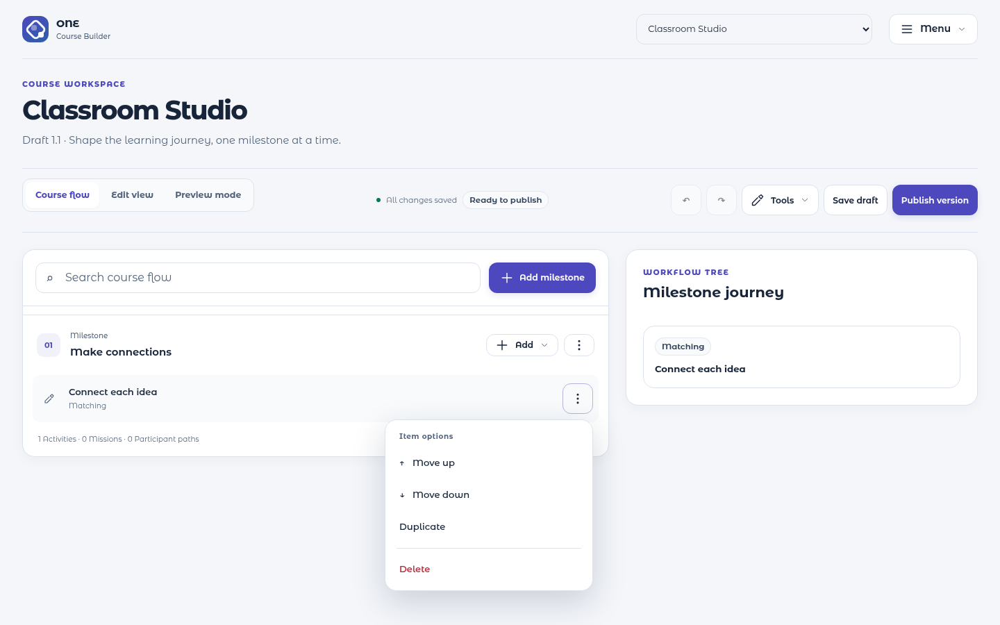
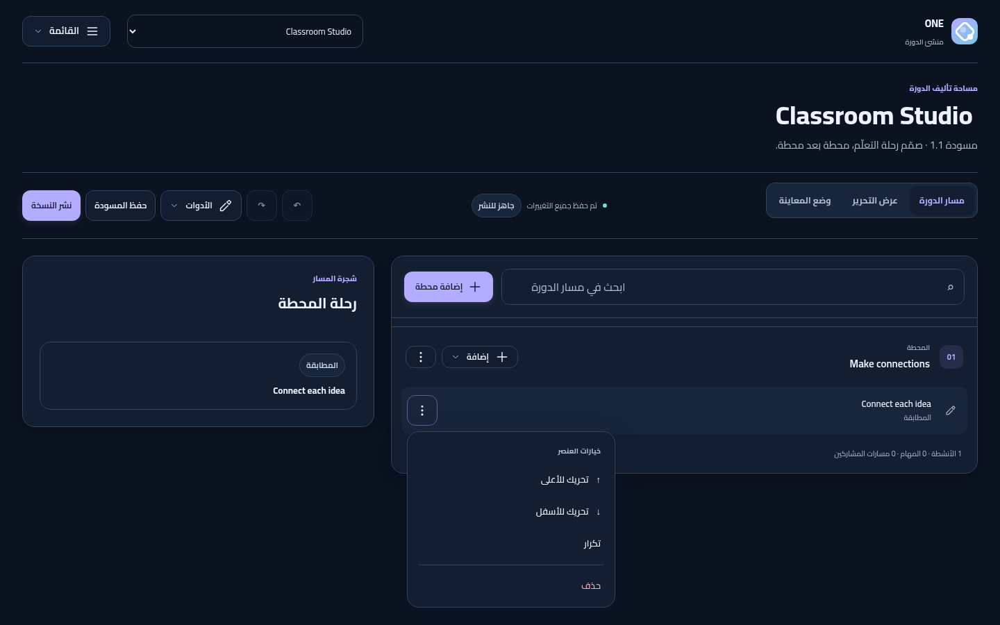
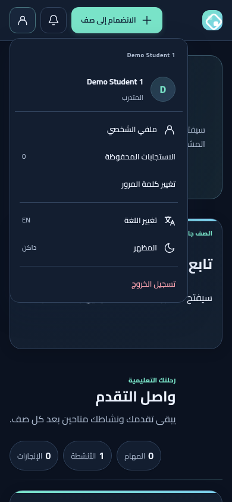
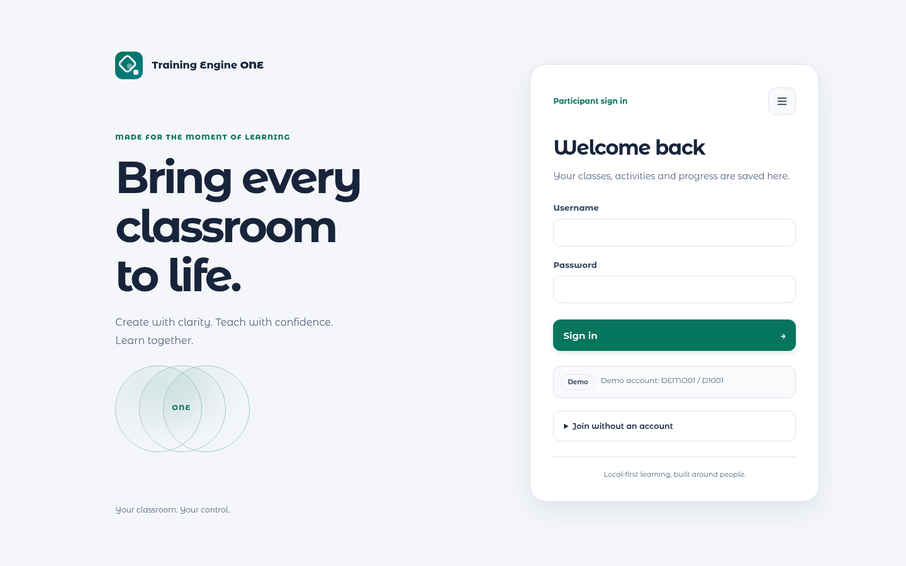
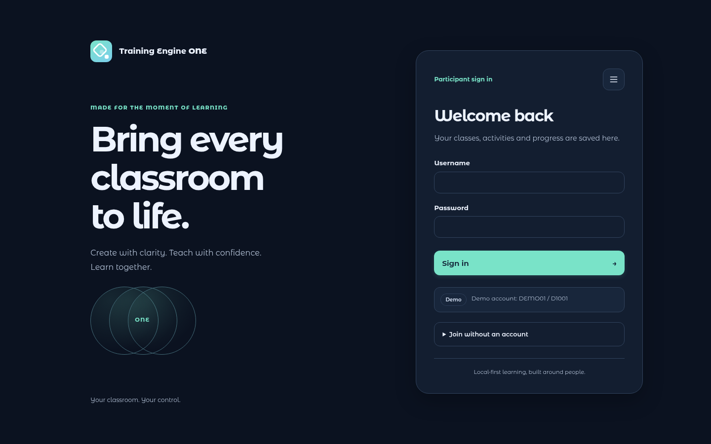
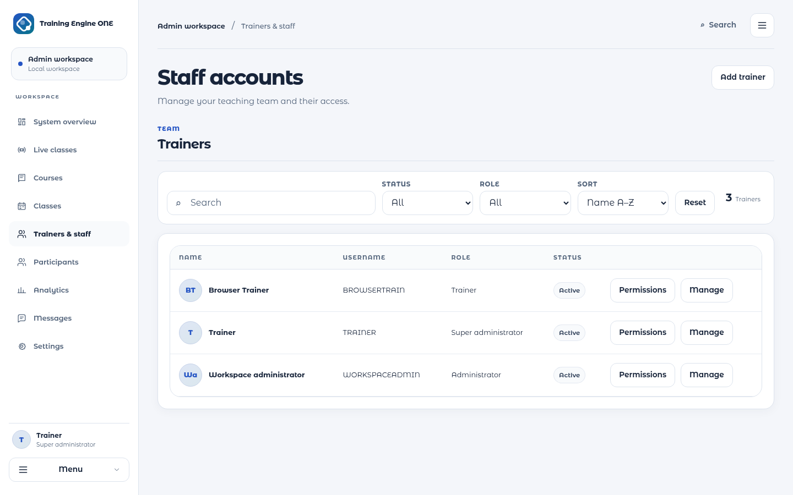
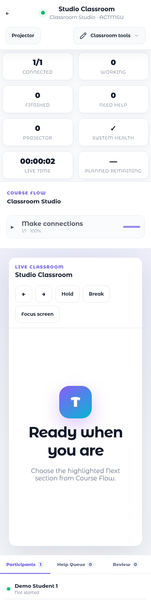
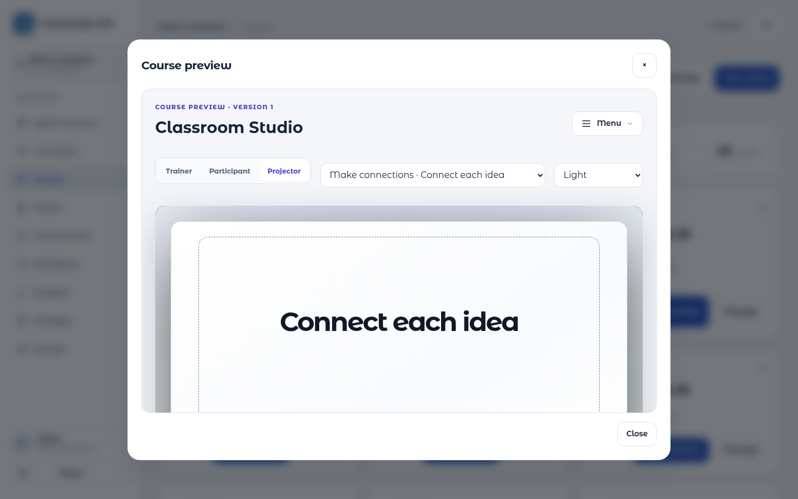

# RC1R7 visual review

These are actual browser captures from the sealed source candidate, using disposable sample data. They show the redesigned surfaces; owner Windows/projector acceptance remains pending.

Builder: essential actions stay visible; item operations live in a menu.

Arabic Builder: RTL layout, Cairo typography and dark appearance.

Participant: a contained account menu and Arabic sentence direction.

Participant entry: readable light appearance and clear sign-in.

Participant entry: the same design system in dark appearance.

Admin: dedicated staff management, actual creation and explicit account roles.

Live Classroom: visible mobile controls and classroom tools.

Actual course preview: authorized version and shared presentation rendering.

